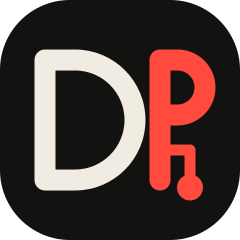
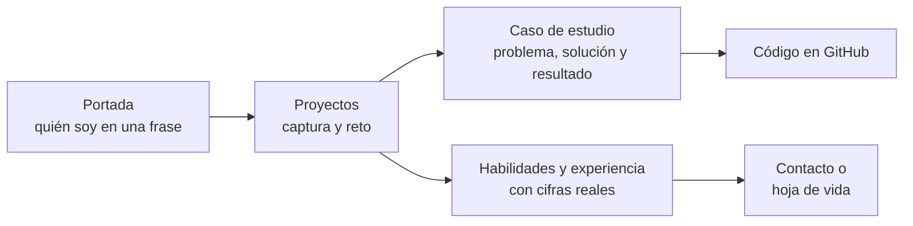
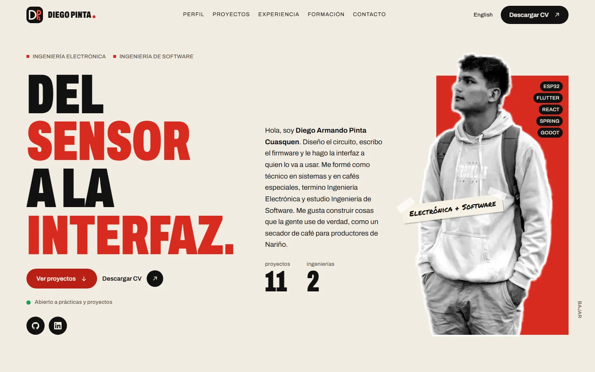
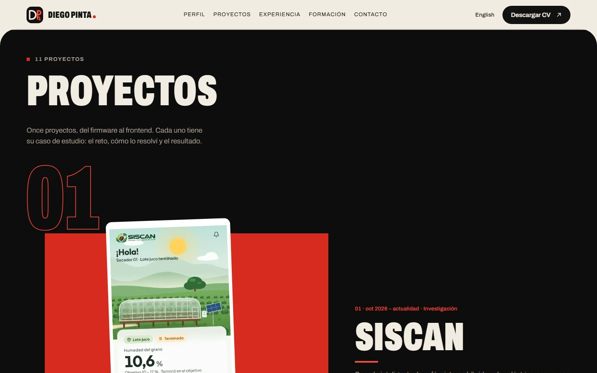
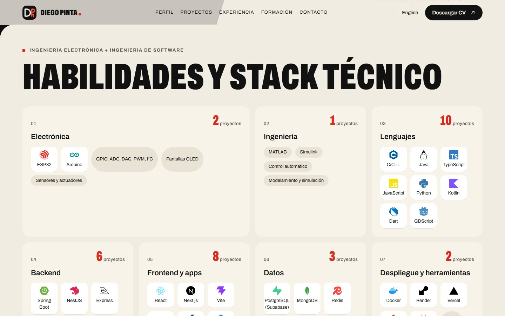
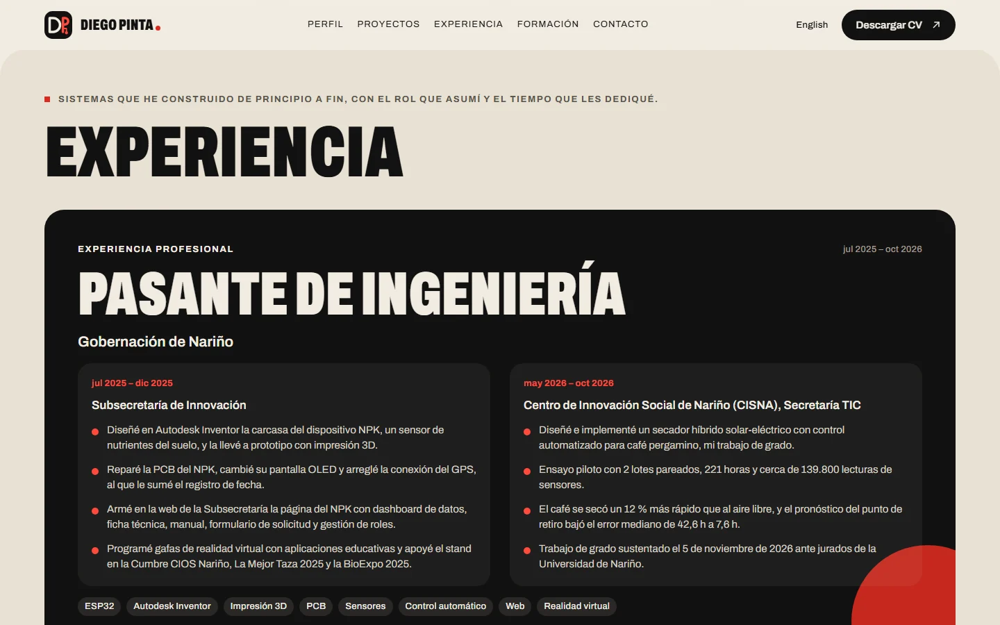
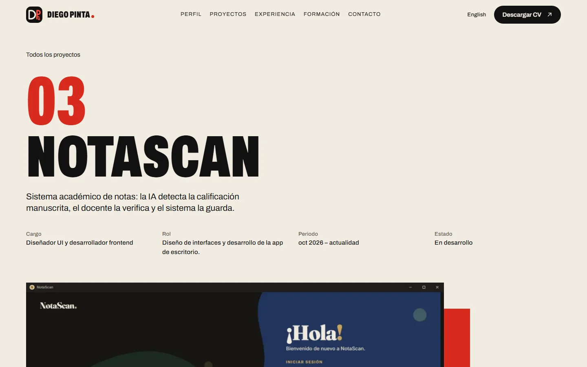
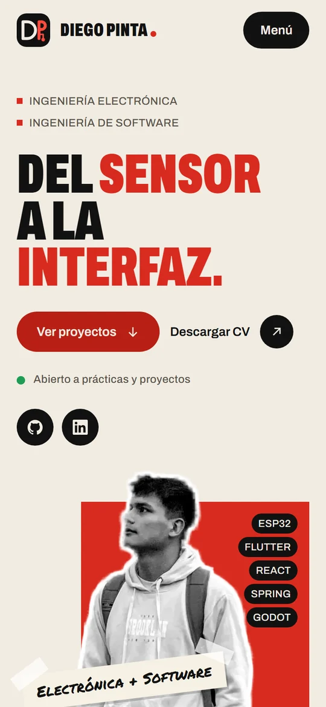

<div align="center">



# Diego Armando Pinta Cuasquen · Portafolio

**Del sensor a la interfaz.**

Ingeniero electrónico y estudiante de Ingeniería de Software. Hago el circuito, el firmware<br/>
y la pantalla que lo usa, y este sitio lo muestra con proyectos reales.


**[Ver el portafolio](https://mi-portafolio-beta-kohl.vercel.app)** · [English](https://mi-portafolio-beta-kohl.vercel.app/en) · [Hoja de vida (PDF)](https://mi-portafolio-beta-kohl.vercel.app/cv-diego-armando-pinta-cuasquen.pdf) · [Cuentas de prueba de mis apps](docs/Cuentas%20de%20prueba.md)

</div>

---

## La idea

Un profesor, un reclutador o un cliente tiene pocos minutos. El sitio está armado para que en ese tiempo vea qué sé hacer y lo pueda comprobar en el proyecto real, con capturas, código y lo que aprendí en cada uno.



## Capturas

<div align="center">



| Proyectos | Habilidades | Experiencia |
|:---:|:---:|:---:|
|  |  |  |
| **Caso de estudio** | **Celular** | |
|  |  | |

</div>

## Qué tiene

### Lo que ve quien entra

- **Portada** con el titular, la foto tipo sticker sobre el bloque rojo y las cifras contadas desde los datos.
- **Once proyectos** en carrusel, del firmware al frontend, con un visor a pantalla completa para ver todas las capturas.
- **Caso de estudio** de cada proyecto en `/proyectos/<id>`, con el reto, lo que hice, la galería y el código.
- **Franja Hardware / Software** que se mueve con el scroll.
- **Habilidades** con los logos reales de cada tecnología y cuántos proyectos la usan.
- **Experiencia** con la pasantía en la Gobernación de Nariño, la monitoría de televisión en la Universidad de Nariño y Pasto Noticias.
- **Testimonios**, contacto y la hoja de vida en PDF en español y en inglés.
- **El mapa en pixel art** de la versión anterior sigue en `/quest`, por si alguien lo quiere recorrer como juego.

### Lo que no se ve

- Español en `/` e inglés en `/en`, con su imagen para redes por idioma y por proyecto.
- Sitemap, robots y metadatos para buscadores.
- Accesibilidad, buenas prácticas y SEO en 100 en Lighthouse.
- Movimiento solo con `transform` y `opacity`, y respeta `prefers-reduced-motion`.
- No pide cuenta ni usa cookies de rastreo. Lo único que se guarda es en el propio navegador (el progreso del mapa de `/quest` y las preferencias). La política está en `/privacidad`.

## Stack

| Capa | Tecnología |
|---|---|
| Framework | Next.js 16 (App Router), React 19, TypeScript |
| Estilos | Tailwind CSS 4, más `app/v2.css`, que se carga después de `globals.css` y manda sobre él |
| Tipografía | Archivo y Permanent Marker |
| Logos | `simple-icons` |
| Hoja de vida | PDF generado desde los mismos datos con `npm run cv` |
| Pruebas | Vitest y Playwright (escritorio y celular) |
| Publicación | Vercel |

```
portafolio-diego
├── app/              rutas en español (es) e inglés (en), imagen para redes, sitemap
├── components/       portada, carrusel, franja, habilidades, experiencia
├── data/             portfolio.ts y projects.ts, todo el contenido del sitio
├── public/           capturas, ilustraciones, retrato y hojas de vida
├── e2e/ y tests/     pruebas de extremo a extremo y unitarias
└── docs/             anexo de diseño, pantallazos, textos legales y cuentas de prueba
```

## Cómo lo diseñamos

La primera versión salió correcta pero plana, y la rehice siguiendo mis referentes (Abdullah Tariq, Axel Morgan, Tetsuo, Cuong Nguyen y Timothy Ronald). El proceso completo, con usuarios, referentes, direcciones, el contrato de diseño y la verificación de cada paso, está en [`docs/ux/anexos/2026-11-10-rediseno-portafolio.md`](docs/ux/anexos/2026-11-10-rediseno-portafolio.md).

## Correrlo en local

```bash
npm install
npm run dev
```

Abre http://localhost:3000.

## Controles del mapa (`/quest`)

| Acción | Tecla |
|---|---|
| Mover al personaje (con el mapa enfocado) | Flechas o `W` `A` `S` `D` |
| Abrir el panel de un edificio | `E` o `Enter` junto a él, o clic en el edificio |
| Cerrar el panel | `Esc` |
| En el celular | Cruceta táctil (mantén pulsado para caminar) y botón **Entrar** |

Los botones **Sonido** y **Noche** van sobre el mapa. El progreso y las preferencias se guardan en el navegador.

## Editar el contenido

El texto vive en `data/portfolio.ts` (identidad, habilidades, formación, idiomas, testimonios, zonas y textos de la interfaz) y en `data/projects.ts` (cada proyecto con su cargo, periodo y caso de estudio), en español e inglés. Todo dato sale de los repositorios de cada proyecto, y la experiencia se genera a partir de los proyectos. El mapa está en `lib/world.ts` (`WORLD_LAYOUT`) y el pixel art en `components/pixel-sprites.tsx`. Editar el contenido no afecta al movimiento.

En `data/projects.ts` cada proyecto tiene:

- `start` y `end` (`"YYYY-MM"` o `"present"`): periodo de trabajo, mostrado como experiencia.
- `links`: repositorios exactos.
- `demo` (opcional): URL de una demo pública. Sin ella, la ficha dice «Sin demo pública».
- `image` (opcional): captura real con `src`, `width`, `height` y `alt` en los dos idiomas.
- `esquema` (opcional): esquema de sistema por etapas para los proyectos sin captura.

Tras cambiar los datos, regenera los dos CV (español e inglés):

```bash
npm run cv
```

## Añadir la captura, la ilustración o el esquema de un proyecto

En el carrusel de proyectos, en la miniatura de experiencia y en la imagen para redes, cada proyecto de `data/projects.ts` muestra lo primero que tenga:

1. `image`, una captura real.
2. `ilustracion`, una ilustración rotulada «Ilustración» (enmienda 14).
3. `esquema`, el esquema de sistema dibujado desde los datos, rotulado «Esquema».
4. La placa roja con el nombre.

En la página de caso manda la captura y, si no hay, el esquema.

Para añadir una ilustración, guarda el archivo en `public/projects/ilustraciones/` en WebP con guion medio y fondo `#F1ECE2`, y añade `ilustracion` con `src`, `width`, `height` y un `alt` en los dos idiomas que empiece por «Ilustración de» y describa el dibujo. Las seis actuales salen de una hoja que Diego generó con IA, recortada con `scripts/recortar-ilustraciones.py`.

Para añadir una captura:

1. Guarda la imagen en `public/projects/` en WebP, con guion medio en el nombre (`agropulse-panel.webp`) y sin ampliarla. 1280 px de ancho bastan.
2. En el proyecto, añade `image` con `src`, `width` y `height` reales del archivo, y `alt` en español e inglés que describa lo que se ve.
3. Anota en un comentario de dónde salió la captura.
4. Si el proyecto tenía `ilustracion` o `esquema`, puedes dejarlos, porque la captura manda. Los proyectos con captura van primero en la lista (enmienda 10), así que muévelo arriba en `base`.

## Cambiar la foto de la portada

La portada lee el retrato de `retrato` en `data/portfolio.ts`. Para cambiar la foto:

1. Copia el archivo nuevo en `public/retrato/`. Mejor en WebP, recortado y con fondo transparente.
2. En `data/portfolio.ts` cambia `src` por la ruta nueva y pon en `ancho` y `alto` las medidas reales del archivo en píxeles.
3. No hace falta tocar el CSS. La proporción y el tope de alto salen de esos datos. El tope es `alto / densidadMinima` (1.5), así la foto nunca se pinta más grande de lo que su resolución permite.
4. Revisa `/sistema/portada` en 390, 768, 1024 y 1440 px.

## Pruebas

```bash
npm run lint
npm test
npm run e2e
npm run build
```

`npm test` ejecuta las pruebas unitarias y de componentes (Vitest). `npm run e2e` compila, levanta el sitio y ejecuta Playwright en escritorio y móvil.

Lighthouse local del rediseño da 100 en accesibilidad, buenas prácticas y SEO, 99 en rendimiento de escritorio y entre 66 y 73 en rendimiento móvil, que es lo que falta mejorar.

Las fuentes estáticas de `assets/fuentes` (para la imagen social y el CV) se regeneran con `npm run build && python scripts/fuentes-estaticas.py`.

## Despliegue

1. Sube el repositorio a GitHub.
2. En [Vercel](https://vercel.com/new), importa el repositorio. La configuración de Next.js se detecta sola.
3. Cada push a la rama principal publica una nueva versión.
4. Si quieres, activa **Analytics** en el panel del proyecto en Vercel. El componente ya está incluido y solo se carga en despliegues de Vercel.

La URL pública se toma de `VERCEL_PROJECT_PRODUCTION_URL` para las etiquetas de redes, el sitemap y robots. El CV enlaza a `PORTFOLIO_URL` de `data/portfolio.ts`, que hoy es la dirección que figura en el repositorio. Si cambia el dominio, actualiza esa constante y ejecuta `npm run cv`.
